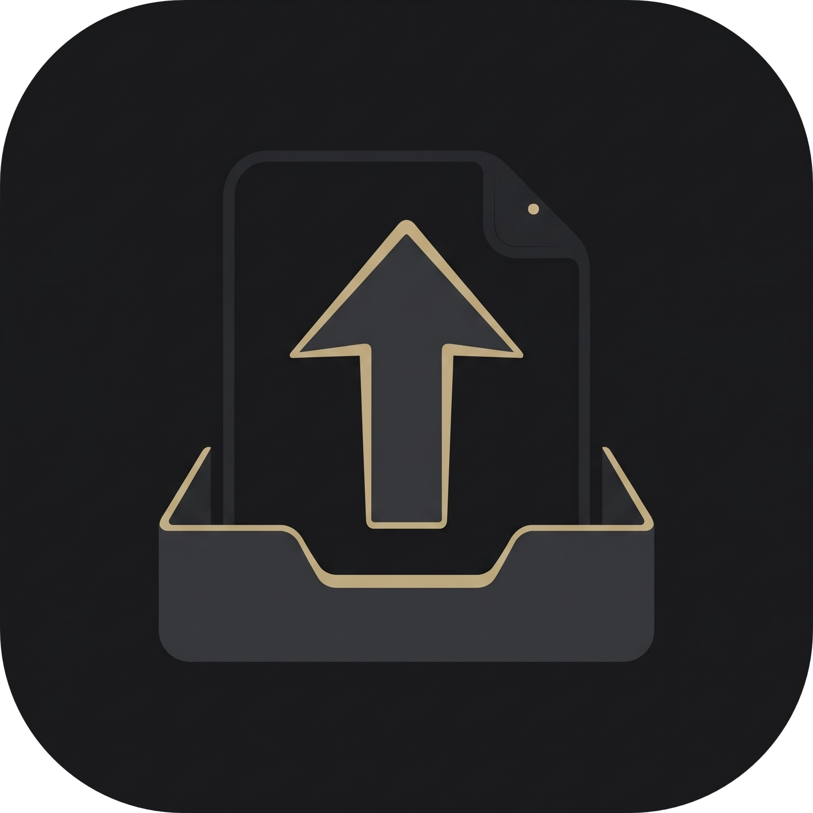
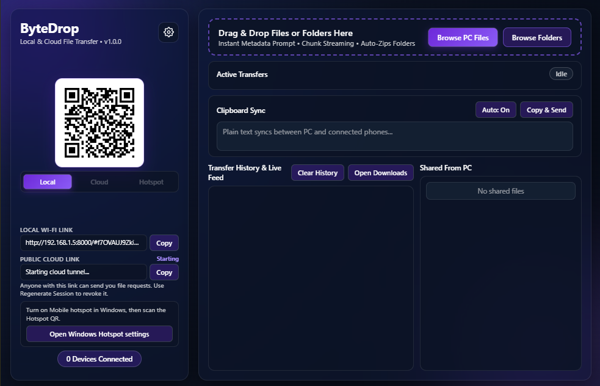
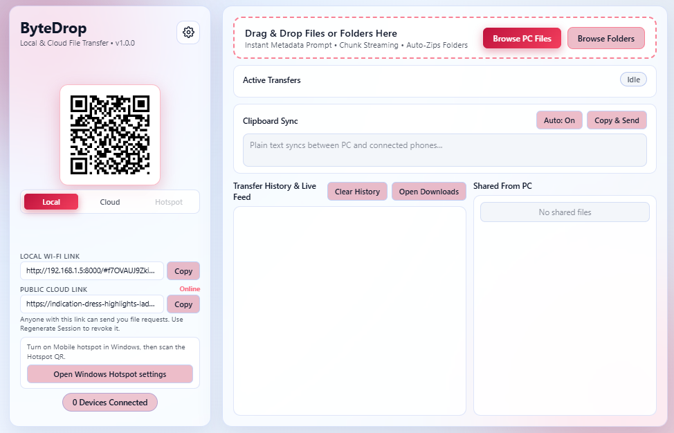
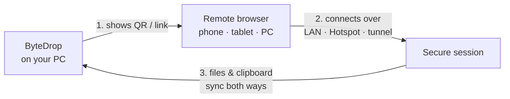

<div align="center">



# ByteDrop

**Fast, zero-configuration file & clipboard transfer between your PC and any browser — phone, tablet, or another PC.**

No accounts. No cables. No cloud storage in between.

[](#requirements)
[](LICENSE)
[](CHANGELOG.md)

[Download](#installation) · [Features](#features) · [How it works](#how-it-works) · [Build from source](#building-from-source)

</div>

<p align="center">
  
  
</p>

---

## 🤔 Why ByteDrop?

Sending a file to your phone — or another computer — shouldn't require signing into three different apps. ByteDrop opens a private, authenticated connection between your PC and any browser on another device: phone, tablet, or a second PC — over your local Wi-Fi, a Windows Mobile Hotspot, or a public link when you're not on the same network — and gets out of your way.

## ✨ Features

- 📡 **Three connection modes**
  - **Local Wi-Fi (LAN)** — instant QR code and authenticated URL on your home network (`TCP 8000–8049`)
  - **Windows Mobile Hotspot** — auto-detects the `192.168.137.1` hotspot adapter with its own QR code
  - **Cloud Link** — one-click global HTTPS tunnel via Cloudflare Quick Tunnels (`trycloudflare.com`), no account needed
- 🔄 **Bidirectional transfers with resume**
  - **Remote device → PC**: multi-file chunked uploads with HTTP Range resume, automatic categorization (Images, Videos, Docs, Audio, Archives, Others), optional auto-accept on trusted networks. Works the same from a phone, tablet, or another PC's browser.
  - **PC → Remote device**: drag-and-drop or file/folder picker; folders stream as a background `.zip` with live progress
- 📋 **Live clipboard sync** — push/pull text between PC and any connected browser
- 📱 **Device management** — see every connected device, block or kick any of them instantly
- 🪶 **Minimal footprint** — all config, history, logs, and lock files live inside `%APPDATA%\ByteDrop`; nothing touches the registry except the optional auto-start entry
- 🎨 **Light & dark themes** with selectable accent colors

## ⚙️ How it works



Each session is protected by a 128-bit random token embedded in the URL fragment (`#token=...`), so it's never sent in a request or written to a log. Repeated failed attempts from an IP are rate-limited and locked out for 5 minutes.

## 📦 Installation

### Option 1 — Portable executable (recommended)

1. Download `ByteDrop.exe` from the [latest release](../../releases/latest).
2. Run it directly — **no installer, no admin rights required.**
3. Cloud Link works immediately with no extra setup. For LAN or Mobile Hotspot mode, Windows may prompt you to allow ByteDrop through the firewall the first time it tries to accept a connection — allow it on **Private** networks only.

### Option 2 — Run from source

```bash
git clone https://github.com/HusseinWalid48/ByteDrop.git
cd ByteDrop
Start.bat
```

`Start.bat` creates an isolated `.venv`, installs pinned dependencies from `requirements.lock.txt`, and launches ByteDrop. First run prompts once to add the LAN firewall rule.

**Requirements for Option 2:**
- Python 3.10+
- [Microsoft Edge WebView2 Runtime](https://developer.microsoft.com/microsoft-edge/webview2/) (usually preinstalled on Windows 10/11)

## 🖥️ Requirements

| | |
|---|---|
| **Fully tested on** | Windows 10 / 11 |
| **Mobile Hotspot mode** | Requires Windows 10/11 — it's a Windows feature, not a ByteDrop limitation |
| **LAN & Cloud Link modes** | Only need Python 3.10+ and WebView2; likely work on older Windows but are untested — issues/PRs welcome |

## 🔒 Security notes

- Session tokens are 128-bit, generated with `secrets.token_urlsafe`, and compared in constant time.
- The bundled `cloudflared` binary is SHA-256 verified against a pinned hash before every execution.
- Cloud Link traffic is distinguished from LAN traffic via Cloudflare's `cf-connecting-ip` header, checked only when the request itself originates from loopback (i.e. actually came through the tunnel) — so it can't be spoofed by a LAN client.

Found a security issue? Please don't open a public issue — report it privately via GitHub's "Report a vulnerability" button under this repo's **Security** tab.

## 🤝 Contributing

Issues and PRs are welcome. For anything non-trivial, please open an issue first to discuss the change.

## 📄 License

This project is licensed under the [MIT License](LICENSE).

---

<div align="center">
<sub>Built with FastAPI, uvicorn, and pywebview.</sub>
</div>
